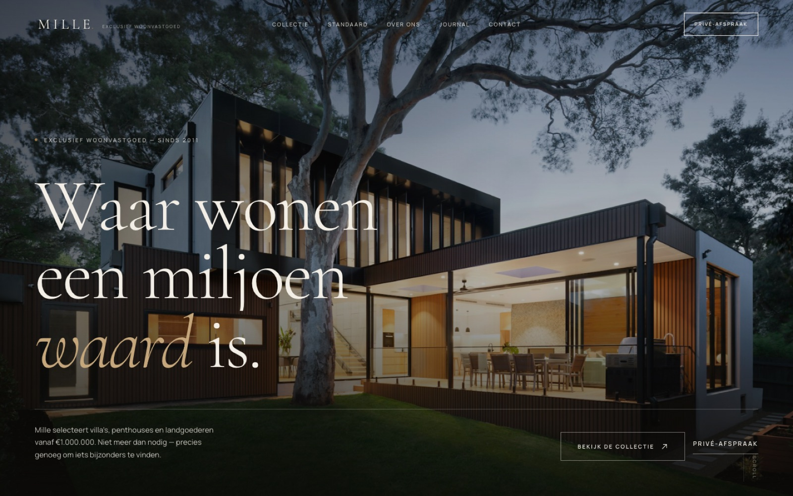

# MILLE — Exclusief woonvastgoed

**Live:** https://moussaonline.github.io/mille/

Een high-end conceptsite voor een fictief makelaarskantoor in villa's, penthouses en landgoederen vanaf €1.000.000. Gebouwd als volledig statische site: geen framework, geen build-stap, geen backend.



## Snel bekijken

De site draait tijdens deze sessie op **http://127.0.0.1:4173**.

Zelf starten:

```bash
cd mille
python3 -m http.server 4173
```

Open daarna <http://127.0.0.1:4173>. De site werkt ook door `index.html` direct te openen, maar een lokale server is aan te raden voor de paginovergangen en lettertypen.

## Pagina's

| Pagina | Bestand | Inhoud |
| --- | --- | --- |
| Home | `index.html` | Hero, filosofie, uitgelichte collectie, Mille-standaard, cijfers, quotes, journal, CTA |
| Collectie | `collectie.html` | 9 objecten, filter op type en regio |
| Objectpagina's | 9 × `villa-*.html`, `penthouse-*.html`, `landgoed-*.html`, `landhuis-*.html` | Presentatie, kenmerken, galerij met lightbox, omgeving, adviseur, vergelijkbare objecten |
| Over ons | `over.html` | Verhaal, waarden, team, tijdlijn |
| Journal | `journal.html` | Drie redactionele verhalen |
| Contact | `contact.html` | Contactgegevens en gevalideerd formulier met successtatus |
| Juridisch | `juridisch.html` | Privacy, voorwaarden en cookies |

## Interactie

- Preloader met woordmerk (alleen bij het eerste bezoek)
- Zachte paginovergangen met een veiler
- Scroll-reveals, parallax in de hero en tellende cijfers
- Custom cursor en magnetische knoppen (alleen desktop)
- Filterbare collectie met live telling
- Lichtbox-galerij met toetsenbordnavigatie (← → en Esc)
- Formuliervalidatie en succesmelding (front-end demo, er wordt niets verstuurd)
- Responsief menu met focusbeheer en `inert` voor de pagina erachter
- Respecteert `prefers-reduced-motion`

## Structuur

```
mille/
├── index.html
├── collectie.html
├── over.html
├── journal.html
├── contact.html
├── juridisch.html
├── villa-*.html, penthouse-*.html, landgoed-*.html, landhuis-*.html
├── css/style.css
├── js/main.js
├── assets/
│   ├── fonts/        # Cormorant Garamond & Manrope (lokaal)
│   ├── img/          # fotografie (lokaal, geoptimaliseerd)
│   └── favicon.svg
└── preview/          # screenshots voor documentatie
```

## Techniek

- Semantische HTML, CSS met custom properties en een 12-koloms grid
- Vanilla JavaScript, geen dependencies
- Lokaal gehoste lettertypen (geen externe requests)
- Toegankelijkheid: skip-link, landmarks, labels, zichtbare focus, reduced motion, focusbeheer in menu en lightbox

## Deployment

De site draait op **GitHub Pages** vanaf de `main`-branch (root). Elke push naar `main` bouwt automatisch opnieuw. De repo is openbaar: <https://github.com/moussaonline/mille>.

## Let op

MILLE, de objecten, prijzen, adressen en het team zijn fictief. De formulieren zijn demo's: ze valideren en tonen een succesmelding, maar versturen geen gegevens. Beeld en lettertypen zijn vrij te gebruiken; zie [CREDITS.md](CREDITS.md).
